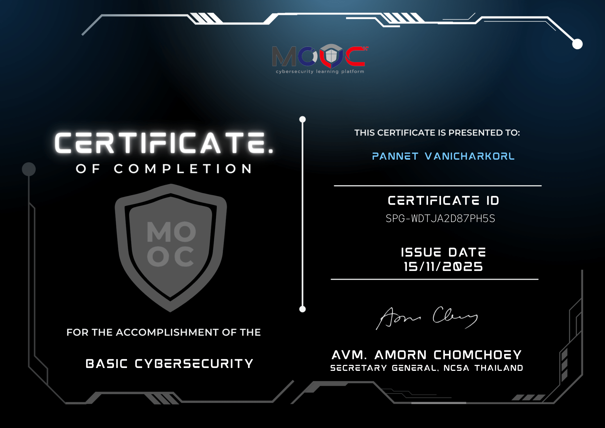

## Overview

The **Basic Cybersecurity Certificate** issued by **NCSA Thailand (MOOC)** verifies foundational knowledge in cybersecurity concepts, risk management, threat vectors, and security best practices.

## Course Coverage

- **Fundamental Concepts**: Confidentiality, Integrity, and Availability (CIA Triad).
- **Threat Awareness**: Malware types, Phishing prevention, Social Engineering defense.
- **Network & Data Safety**: Password policies, data encryption, and safe browsing habits.
