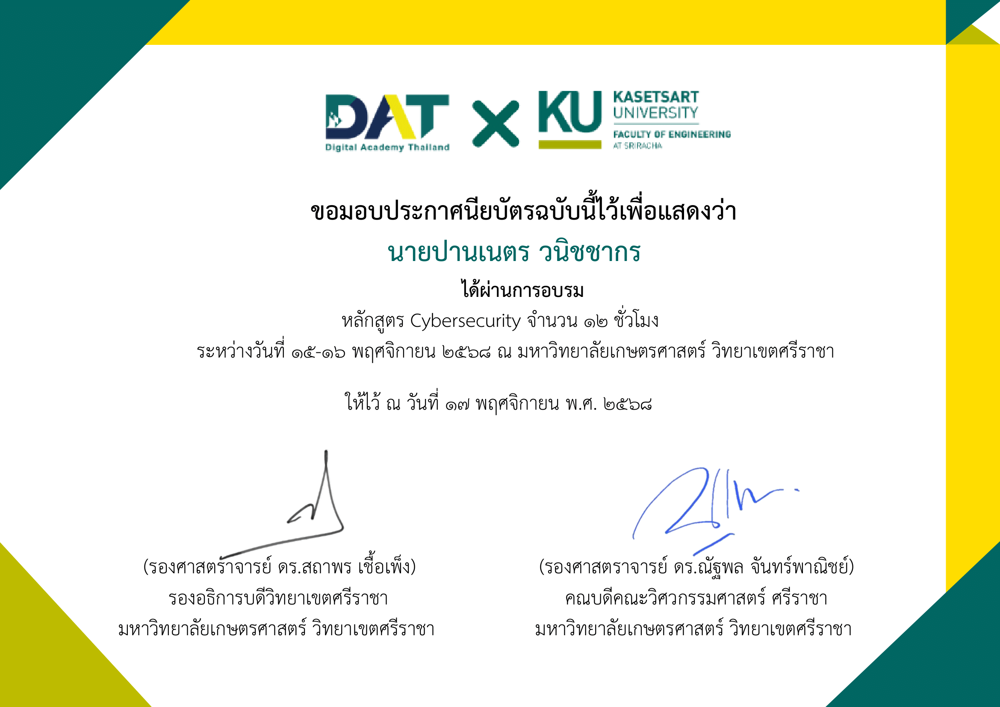

## Overview

Comprehensive hands-on training conducted jointly by **Digital Academy Thailand** and **Kasetsart University**, focusing on advanced cybersecurity operations, incident analysis, and web security.

## Training Modules

- **Web Vulnerabilities**: Hands-on analysis of OWASP Top 10 vulnerabilities (XSS, SQL Injection, CSRF).
- **Incident Response**: Log analysis, threat identification, and remediation techniques.
- **Security Auditing**: Basics of penetration testing tools and vulnerability scanning.
