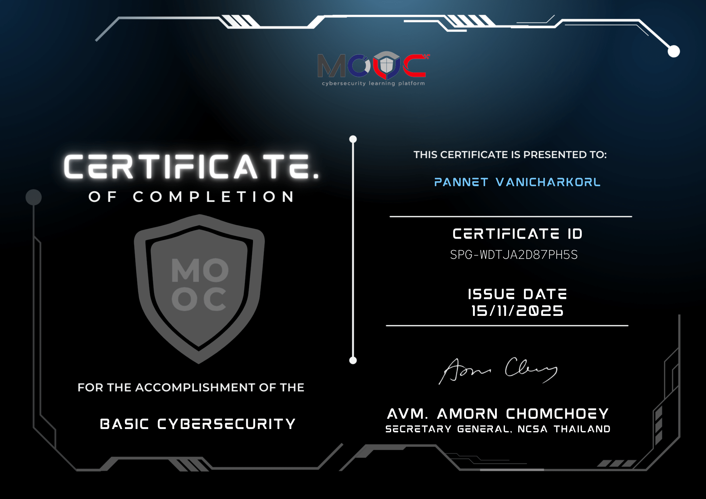

## ภาพรวม

**ใบรับรอง Basic Cybersecurity** ออกโดย **NCSA Thailand (MOOC)** รับรองความรู้พื้นฐานด้านแนวคิดความปลอดภัยไซเบอร์ การบริหารความเสี่ยง ช่องทางการโจมตี และแนวปฏิบัติที่ดีด้านความปลอดภัย

## เนื้อหาหลักสูตร

- **แนวคิดพื้นฐาน**: การรักษาความลับ ความถูกต้องครบถ้วน และความพร้อมใช้งาน (CIA Triad)
- **การรู้เท่าทันภัยคุกคาม**: ประเภทของมัลแวร์ การป้องกัน Phishing และการรับมือกับ Social Engineering
- **ความปลอดภัยของเครือข่ายและข้อมูล**: นโยบายรหัสผ่าน การเข้ารหัสข้อมูล และพฤติกรรมการท่องเว็บอย่างปลอดภัย
