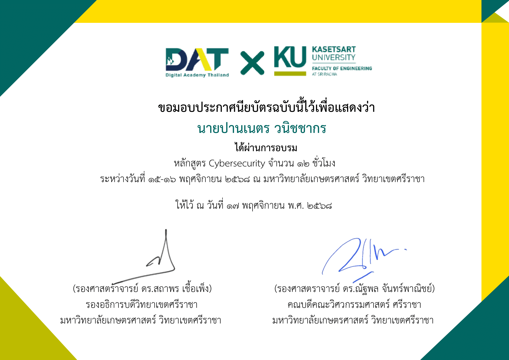

# Cybersecurity Training Program

## ภาพรวม

การอบรมเชิงปฏิบัติการอย่างครอบคลุมที่จัดร่วมกันโดย **Digital Academy Thailand** และ **มหาวิทยาลัยเกษตรศาสตร์** มุ่งเน้นงานปฏิบัติการความปลอดภัยไซเบอร์ขั้นสูง การวิเคราะห์เหตุการณ์ด้านความปลอดภัย และความปลอดภัยของเว็บ

## หัวข้อการอบรม

- **ช่องโหว่ของเว็บ**: วิเคราะห์ช่องโหว่ตาม OWASP Top 10 เชิงปฏิบัติ (XSS, SQL Injection, CSRF)
- **การรับมือเหตุการณ์ (Incident Response)**: การวิเคราะห์ log การระบุภัยคุกคาม และเทคนิคการแก้ไข
- **การตรวจสอบความปลอดภัย**: พื้นฐานการใช้เครื่องมือทดสอบเจาะระบบและการสแกนหาช่องโหว่
