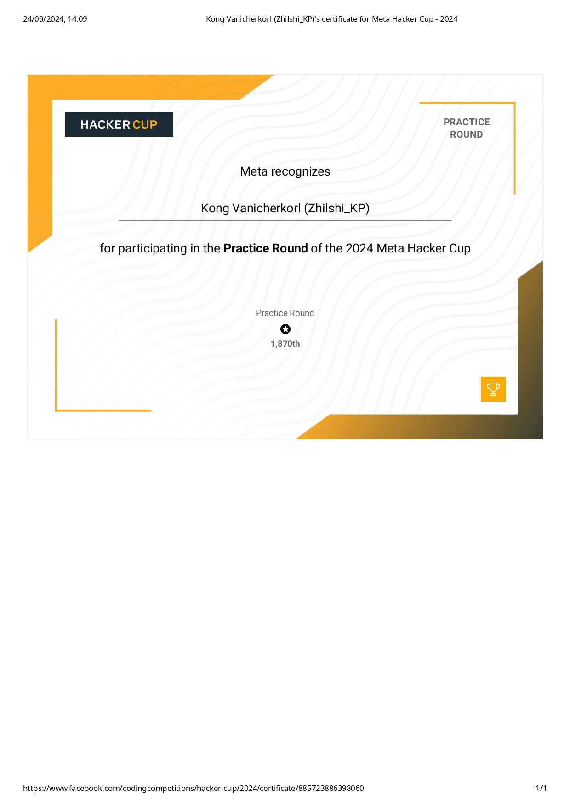

## Event Overview

The **Meta Hacker Cup** is Meta's annual international algorithmic programming contest. Competitors around the world solve algorithmic puzzles under timed constraints.

## Highlights

- **Global Competition**: Competed with thousands of software engineers and students globally.
- **Advanced Problem Solving**: Solved intricate graph, number theory, and dynamic programming challenges in C++.
