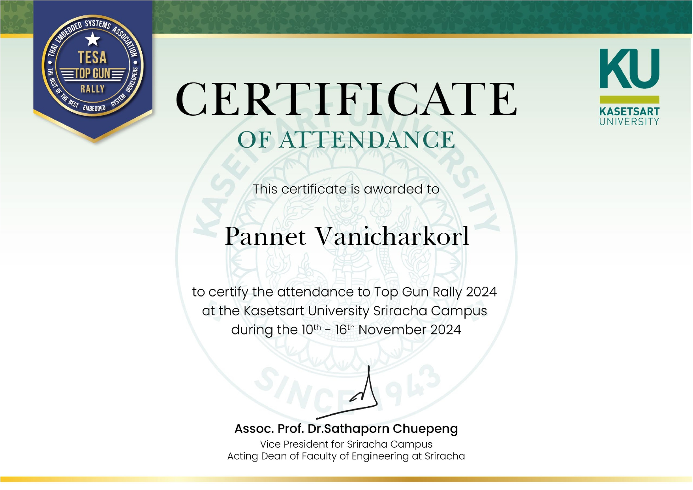
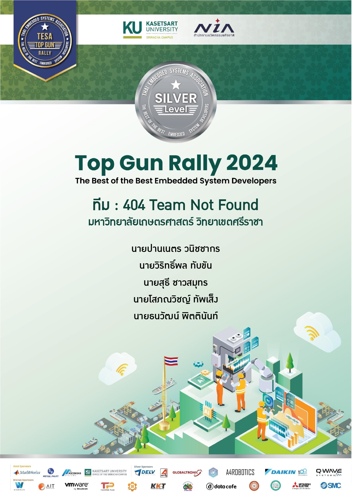

# TESA Top Gun Rally 2024 - Silver Medal

## Event Overview

The **TESA Top Gun Rally** is one of Thailand's most prestigious embedded systems and software technology competitions, bringing together top university engineering teams to solve complex real-world challenges.

## Achievements & Honors

- **Silver Medal Winner**: Awarded Silver Medal for engineering excellence and innovation.
- **Team Collaboration**: Worked under intensive rally conditions to design, prototype, and present working technology solutions.
- **Practical Engineering**: Applied hardware-software integration, system design, and rapid prototyping.
