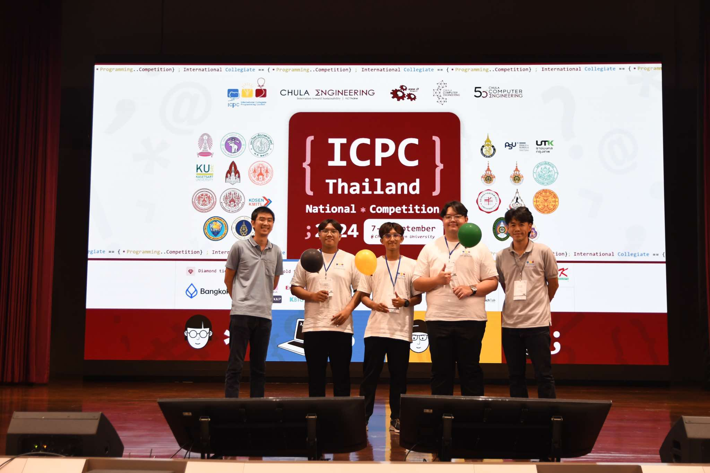

# ICPC Thailand National Competition 2024

## ภาพรวม

เข้าร่วมการแข่งขัน **2024 ICPC Thailand National Competition** แก้โจทย์อัลกอริทึมระดับสูงด้วย C++ ร่วมกับเพื่อนร่วมทีมที่มีความสามารถ ในฐานะตัวแทนมหาวิทยาลัยเกษตรศาสตร์ วิทยาเขตศรีราชา
