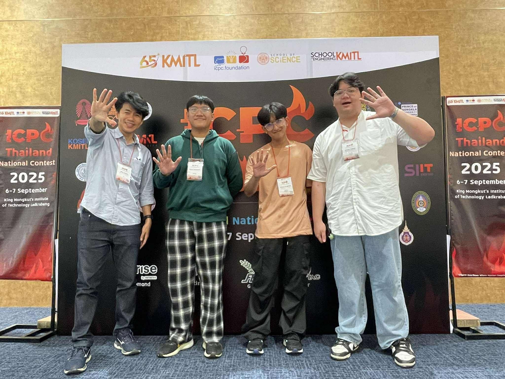
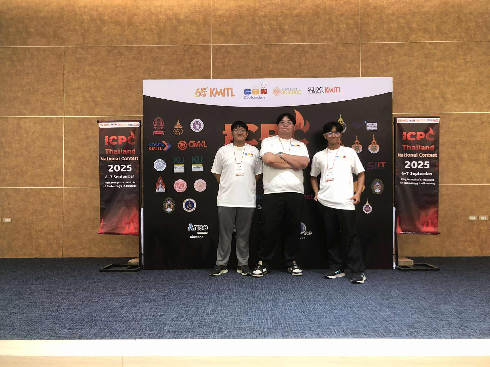

# ICPC Thailand National Competition 2025

## ภาพรวมการแข่งขัน

**International Collegiate Programming Contest (ICPC)** คือการแข่งขันเขียนโปรแกรมระดับโลกที่สำคัญที่สุดสำหรับนักศึกษามหาวิทยาลัย

## ไฮไลต์สำคัญ

- **ระดับประเทศ**: เป็นตัวแทนมหาวิทยาลัยเกษตรศาสตร์ วิทยาเขตศรีราชา ในรอบชิงชนะเลิศระดับประเทศ
- **แก้ปัญหาภายใต้แรงกดดัน**: แก้โจทย์คณิตศาสตร์และอัลกอริทึมที่ซับซ้อนภายในเวลาจำกัด 5 ชั่วโมง
- **ทักษะหลัก**: Graph Theory, Dynamic Programming, Segment Tree และการปรับประสิทธิภาพโค้ด C++
