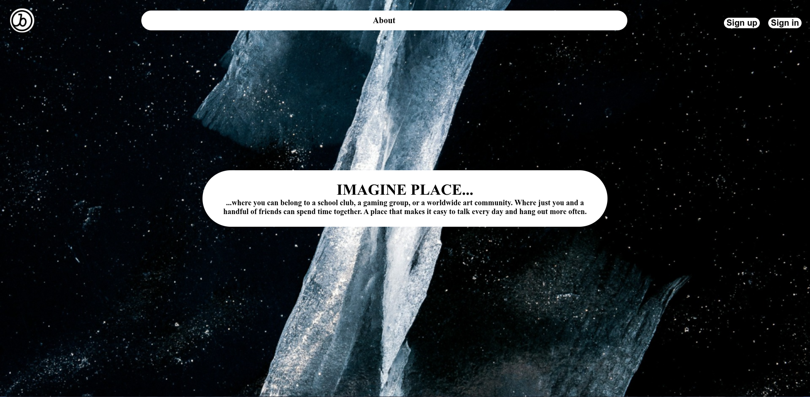

# ChatRoom Application

## Overview

**ChatRoom** is a multi-user real-time chat application built to enable seamless messaging between concurrent users with instant WebSocket synchronization.

## Key Features

- **Instant Messaging**: Real-time message broadcast using WebSockets.
- **Multi-User Rooms**: Join public or private chat channels.
- **Responsive Web UI**: Built for desktop and mobile browsers.

## Tech Stack

- **Frontend**: JavaScript, HTML5, CSS3
- **Backend**: Node.js, WebSocket API
- **Live Demo**: [chat-with-chock.vercel.app](https://chat-with-chock.vercel.app)
- **Source Code**: [GitHub Repository](https://github.com/Zhilshi04/ChatRoom.git)
