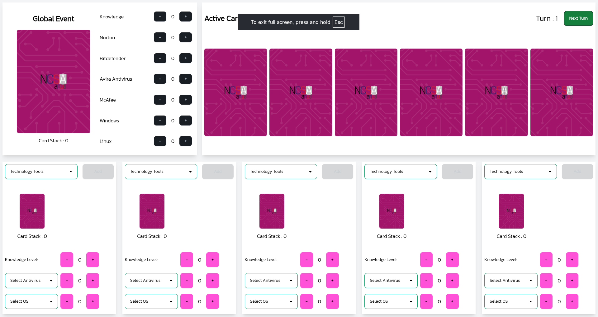

# CyberArena

## Overview

**CyberArena** is an interactive web-based card game created to educate and raise awareness about cybersecurity threats, defense strategies, and vulnerability mitigation through gamified mechanics.

## Key Features

- **Cyber Threat Simulation**: Learn real-world attack vectors (Phishing, DDoS, Malware) and defense countermeasures.
- **Card-Based Gameplay**: Strategic turn-based card battles simulating security incidents.
- **Modern Web Interface**: Developed with Next.js and Tailwind CSS for smooth animations and dark theme visuals.

## Tech Stack & Links

- **Framework**: Next.js, React, TypeScript
- **Styling**: Tailwind CSS
- **Live Demo**: [cyberarena.vercel.app](https://cyberarena.vercel.app)
- **Source Code**: [GitHub Repository](https://github.com/KPV2004/cyberarena.git)
