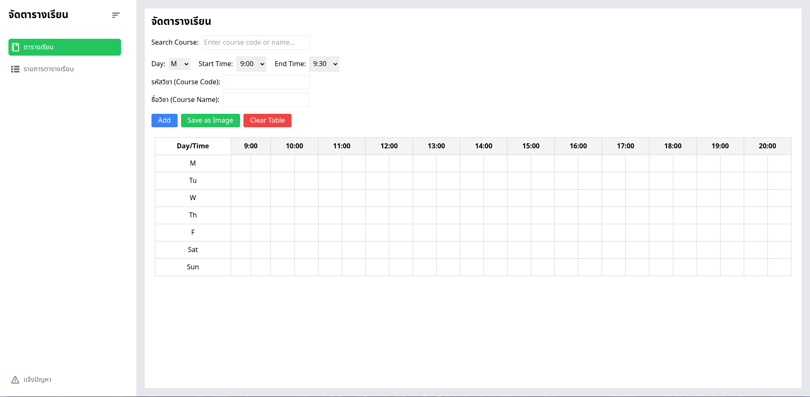
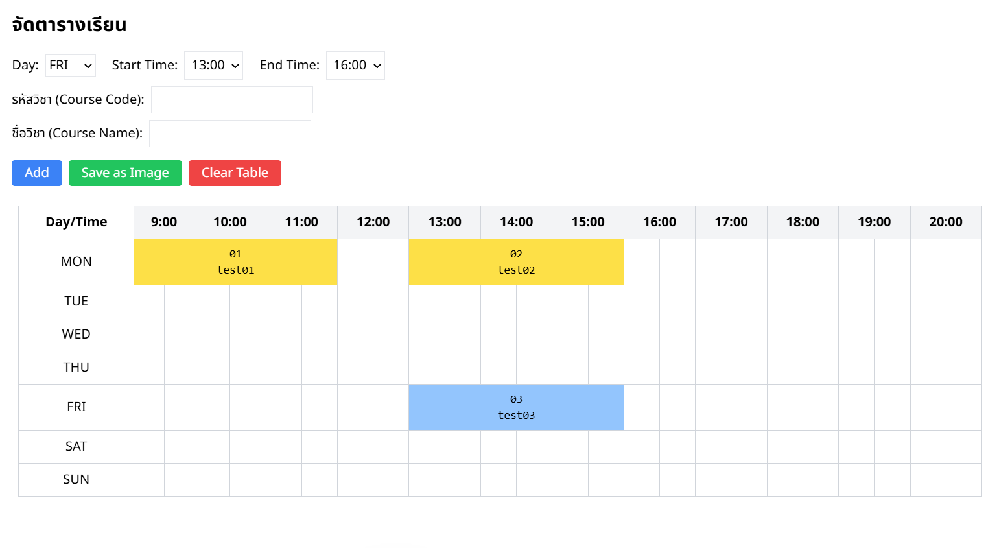

## Overview

**KU Schedule** is a web application designed specifically for Kasetsart University students to organize, customize, and export their semester class schedules with ease.

## Key Features

- **Course Management**: Add, edit, and organize class timetables visually.
- **Image Export**: Export custom schedules as clean image graphics for sharing with friends.
- **Responsive Layout**: Works seamlessly on mobile and desktop browsers.

## Tech Stack & Links

- **Language**: JavaScript, HTML5, CSS3
- **Live Demo**: [ku-schedule.vercel.app](https://ku-schedule.vercel.app)
- **Source Code**: [GitHub Repository](https://github.com/KPV2004/KU-Schedule.git)
