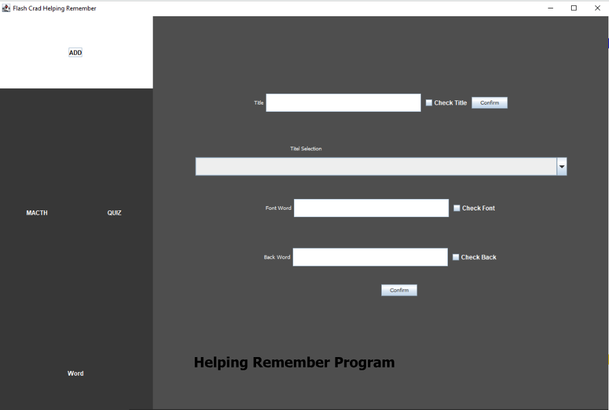
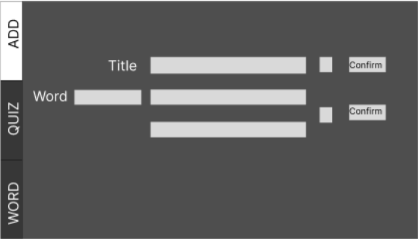
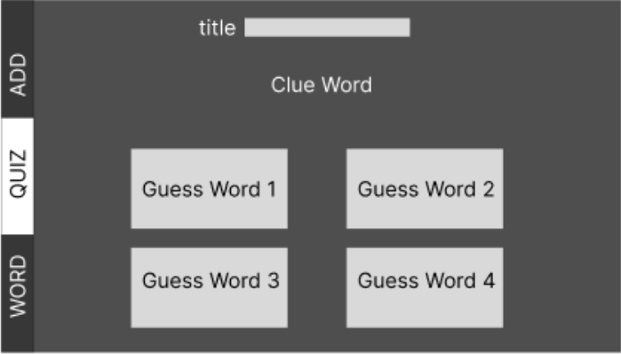
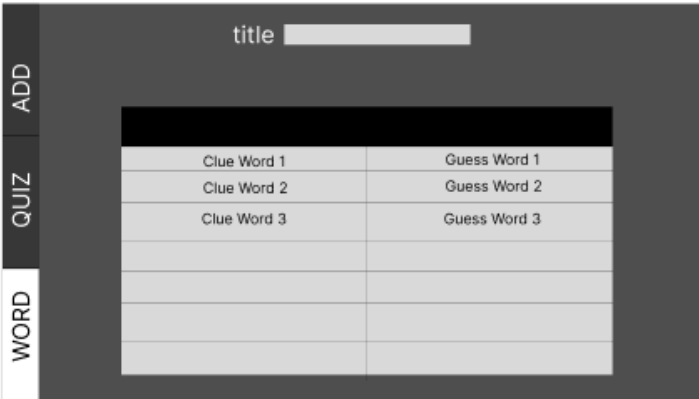

# Remember Card Project

## Overview

**Remember Card Project** is a Java-based desktop application created to help users memorize vocabulary efficiently using spaced repetition and interactive mini-games.

## Screenshot Gallery

## Key Features

- **Interactive Vocabulary Cards**: Practice and memorize word definitions with flashcards.
- **Mini-Games Integration**: Learn through engaging games to test memory retention.
- **Progress Tracking**: Keep track of mastered words and study statistics.

## Technical Details

- **Language**: Java
- **UI Framework**: Java Swing / JavaFX
- **Source Code**: [GitHub Repository](https://github.com/Zhilshi04/Remember-Crad-Project-Java.git)
