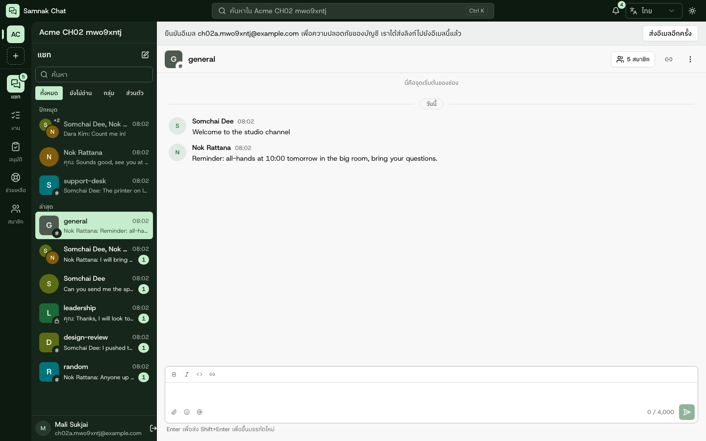

# Samnak Chat

## Overview

**Samnak Chat** is a self-hosted chat for organizations, with work management built in. Tasks, approval requests and a helpdesk can all be used from inside a conversation.

## Key Features

- **Chat**: Channels, direct messages, threads, reactions, pins, file attachments, slash commands and realtime delivery.
- **Workspaces**: Members and roles, invites, groups and an audit log.
- **Tasks & Approvals**: Task reminders and approval requests that appear as cards in chat.
- **Helpdesk**: Queues, categories, tickets, assignment and a ticket made from a chat message.
- **Modular Server**: Optional modules are switched on with `MODULES_ENABLED`; disabled modules return 404 and hide their menu items.
- **Bilingual UI**: Thai and English, light and dark themes, responsive on phones and desktops.

## Tech Stack

- **Backend**: Go modular monolith
- **Frontend**: React and TypeScript
- **Infrastructure**: PostgreSQL, Redis, MinIO and Docker Compose
- **Live Demo**: [kpv2004.github.io/samnak-chat](https://kpv2004.github.io/samnak-chat/)
- **Source Code**: [GitHub Repository](https://github.com/KPV2004/samnak-chat)
