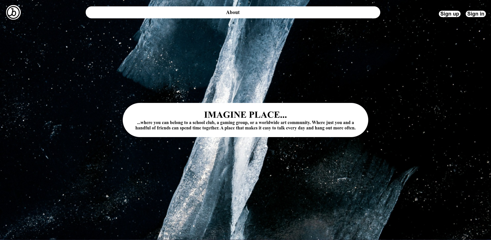

# แอปพลิเคชัน ChatRoom

## ภาพรวม

**ChatRoom** คือแอปพลิเคชันแชตแบบเรียลไทม์สำหรับผู้ใช้หลายคน สร้างขึ้นเพื่อให้ผู้ใช้ที่ออนไลน์พร้อมกันส่งข้อความหากันได้อย่างราบรื่น โดยซิงก์ข้อมูลทันทีผ่าน WebSocket

## ฟีเจอร์หลัก

- **ส่งข้อความทันที**: กระจายข้อความถึงผู้ใช้แบบเรียลไทม์ด้วย WebSocket
- **ห้องแชตหลายผู้ใช้**: เข้าร่วมช่องแชตได้ทั้งแบบสาธารณะและแบบส่วนตัว
- **หน้าเว็บแบบ Responsive**: ใช้งานได้ทั้งบนเบราว์เซอร์เดสก์ท็อปและมือถือ

## เทคโนโลยีที่ใช้

- **Frontend**: JavaScript, HTML5, CSS3
- **Backend**: Node.js, WebSocket API
- **เดโมใช้งานจริง**: [chat-with-chock.vercel.app](https://chat-with-chock.vercel.app)
- **ซอร์สโค้ด**: [GitHub Repository](https://github.com/Zhilshi04/ChatRoom.git)
