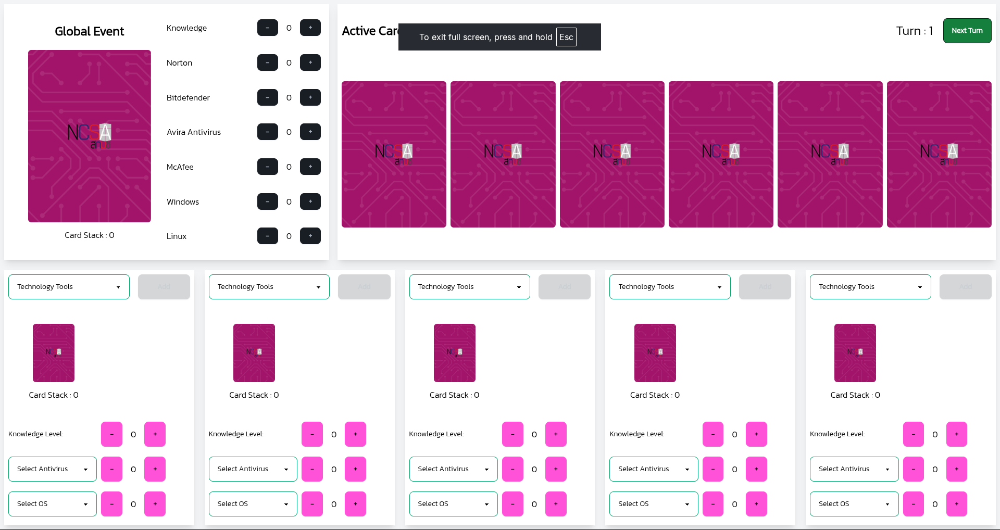

## ภาพรวม

**CyberArena** คือเกมการ์ดอินเทอร์แอกทีฟบนเว็บ สร้างขึ้นเพื่อให้ความรู้และสร้างความตระหนักรู้เกี่ยวกับภัยคุกคามไซเบอร์ กลยุทธ์การป้องกัน และการลดความเสี่ยงจากช่องโหว่ ผ่านกลไกแบบเกม

## ฟีเจอร์หลัก

- **จำลองภัยคุกคามไซเบอร์**: เรียนรู้รูปแบบการโจมตีจริง (Phishing, DDoS, Malware) และวิธีรับมือ
- **เกมเพลย์แบบการ์ด**: ต่อสู้ด้วยการ์ดแบบผลัดกันเล่นเชิงกลยุทธ์ ที่จำลองเหตุการณ์ด้านความปลอดภัย
- **หน้าเว็บทันสมัย**: พัฒนาด้วย Next.js และ Tailwind CSS ให้แอนิเมชันลื่นไหลและมีภาพลักษณ์แบบธีมมืด

## เทคโนโลยีและลิงก์

- **Framework**: Next.js, React, TypeScript
- **Styling**: Tailwind CSS
- **เดโมใช้งานจริง**: [cyberarena.vercel.app](https://cyberarena.vercel.app)
- **ซอร์สโค้ด**: [GitHub Repository](https://github.com/KPV2004/cyberarena.git)
