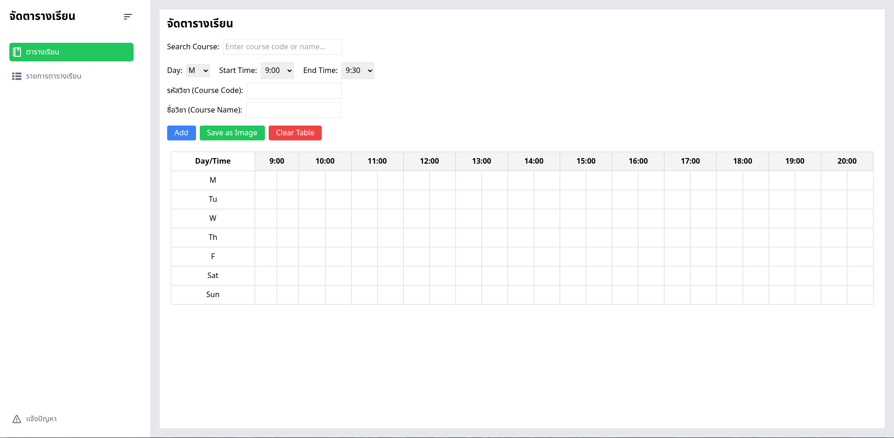
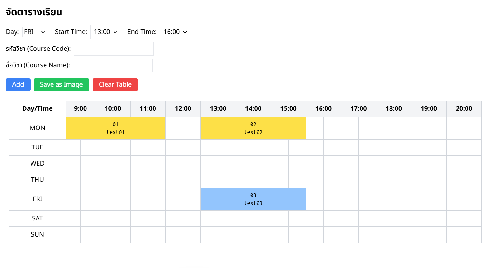

## ภาพรวม

**KU Schedule** คือเว็บแอปพลิเคชันที่ออกแบบมาสำหรับนิสิตมหาวิทยาลัยเกษตรศาสตร์โดยเฉพาะ ช่วยให้จัดระเบียบ ปรับแต่ง และส่งออกตารางเรียนในแต่ละภาคการศึกษาได้อย่างง่ายดาย

## ฟีเจอร์หลัก

- **จัดการรายวิชา**: เพิ่ม แก้ไข และจัดตารางเรียนได้ด้วยภาพที่เห็นชัดเจน
- **ส่งออกเป็นรูปภาพ**: ส่งออกตารางที่ปรับแต่งแล้วเป็นรูปภาพสวยงามเพื่อแชร์ให้เพื่อน
- **เลย์เอาต์แบบ Responsive**: ใช้งานได้อย่างราบรื่นทั้งบนเบราว์เซอร์มือถือและเดสก์ท็อป

## เทคโนโลยีและลิงก์

- **ภาษา**: JavaScript, HTML5, CSS3
- **เดโมใช้งานจริง**: [ku-schedule.vercel.app](https://ku-schedule.vercel.app)
- **ซอร์สโค้ด**: [GitHub Repository](https://github.com/KPV2004/KU-Schedule.git)
