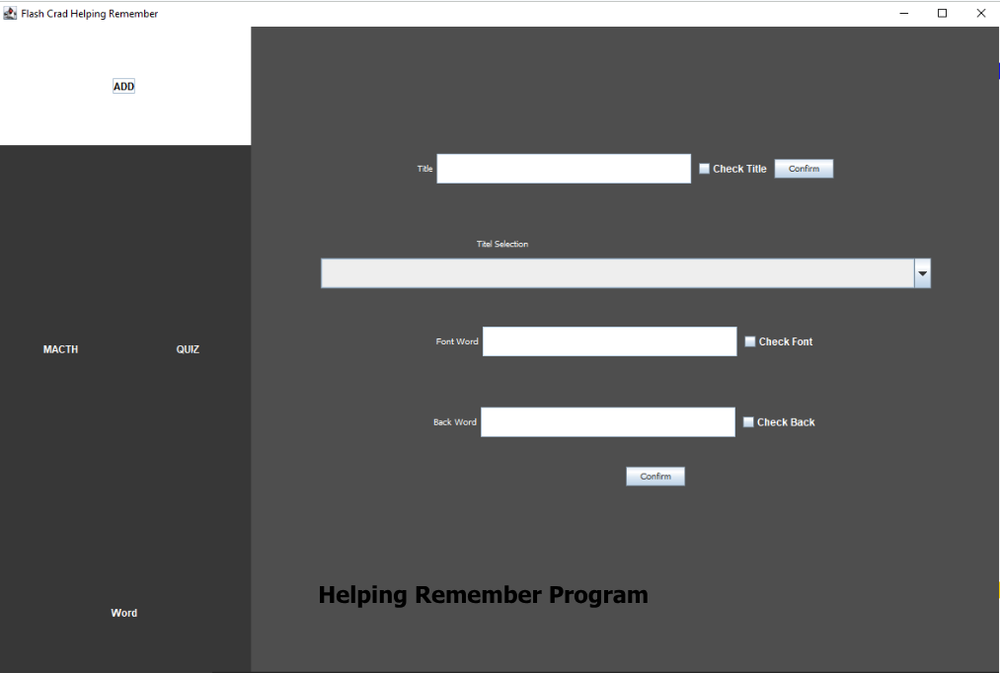
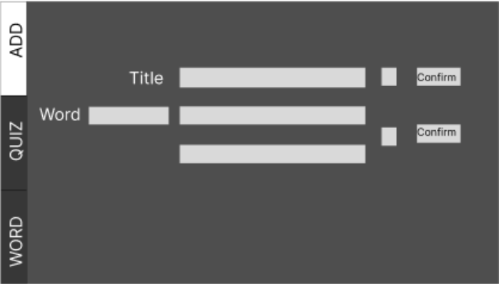
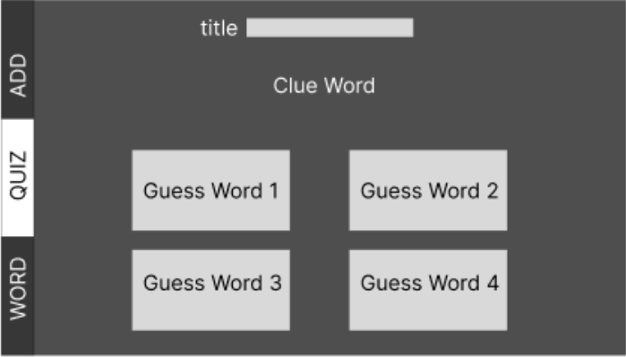
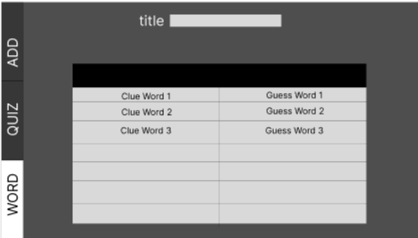

# Remember Card Project

## ภาพรวม

**Remember Card Project** คือแอปพลิเคชันเดสก์ท็อปที่พัฒนาด้วย Java เพื่อช่วยให้ผู้ใช้ท่องจำคำศัพท์ได้อย่างมีประสิทธิภาพ ด้วยเทคนิคการทบทวนแบบเว้นระยะ (spaced repetition) และมินิเกมแบบอินเทอร์แอกทีฟ

## แกลเลอรีภาพหน้าจอ

## ฟีเจอร์หลัก

- **การ์ดคำศัพท์แบบอินเทอร์แอกทีฟ**: ฝึกและท่องจำความหมายของคำด้วยแฟลชการ์ด
- **มินิเกมในตัว**: เรียนรู้ผ่านเกมที่สนุกเพื่อทดสอบความจำ
- **ติดตามความก้าวหน้า**: บันทึกคำที่จำได้แล้วและสถิติการเรียน

## รายละเอียดทางเทคนิค

- **ภาษา**: Java
- **UI Framework**: Java Swing / JavaFX
- **ซอร์สโค้ด**: [GitHub Repository](https://github.com/Zhilshi04/Remember-Crad-Project-Java.git)
