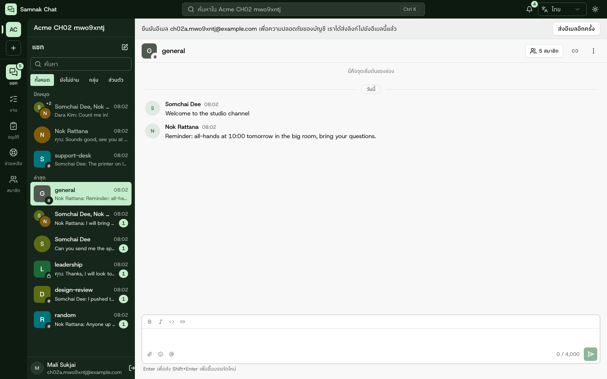

## ภาพรวม

**Samnak Chat** คือระบบแชตสำหรับองค์กรแบบ self-hosted ที่มีระบบจัดการงานในตัว ผู้ใช้สามารถจัดการงาน ส่งคำขออนุมัติ และใช้ helpdesk ได้จากภายในบทสนทนาโดยตรง

## ฟีเจอร์หลัก

- **แชต**: ช่องสนทนา ข้อความส่วนตัว เธรด การแสดงความรู้สึก การปักหมุด ไฟล์แนบ คำสั่งแบบ slash และการส่งข้อความแบบเรียลไทม์
- **Workspace**: จัดการสมาชิกและบทบาท คำเชิญ กลุ่ม และบันทึกการตรวจสอบ (audit log)
- **งานและการอนุมัติ**: การแจ้งเตือนงานและคำขออนุมัติที่แสดงเป็นการ์ดในแชต
- **Helpdesk**: คิวงาน หมวดหมู่ ทิกเก็ต การมอบหมายงาน และการสร้างทิกเก็ตจากข้อความในแชต
- **เซิร์ฟเวอร์แบบโมดูล**: เปิดใช้โมดูลเสริมได้ผ่าน `MODULES_ENABLED` โมดูลที่ปิดอยู่จะตอบกลับเป็น 404 และซ่อนเมนูที่เกี่ยวข้อง
- **UI สองภาษา**: รองรับภาษาไทยและอังกฤษ ธีมสว่างและมืด และแสดงผลได้ดีทั้งบนมือถือและเดสก์ท็อป

## เทคโนโลยีที่ใช้

- **Backend**: Go modular monolith
- **Frontend**: React และ TypeScript
- **Infrastructure**: PostgreSQL, Redis, MinIO และ Docker Compose
- **เดโมใช้งานจริง**: [kpv2004.github.io/samnak-chat](https://kpv2004.github.io/samnak-chat/)
- **ซอร์สโค้ด**: [GitHub Repository](https://github.com/KPV2004/samnak-chat)
